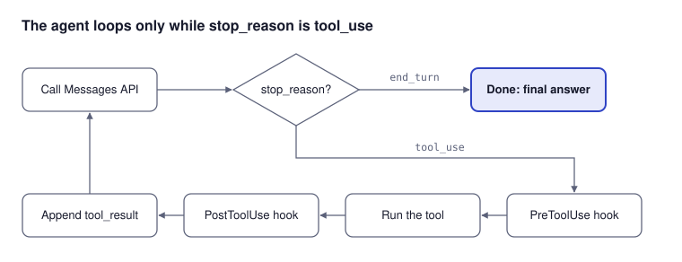

# Domain 1: Agentic Architecture & Orchestration

How autonomous agents loop, delegate, enforce rules and keep state. This is the biggest domain, so give it a full hour.

### 1.1 Agentic loops

```
while True:
    resp = client.messages.create(model=..., tools=tools, messages=messages)
    messages.append({"role": "assistant", "content": resp.content})
    if resp.stop_reason != "tool_use":   # "end_turn" -> done
        break
    results = [run(b) for b in resp.content if b.type == "tool_use"]
    messages.append({"role": "user", "content": results})  # tool_result blocks
```



*The pre-call hook is where must-always rules live (block a $600 refund, redirect to escalation). The post-call hook normalizes and trims results before Claude reads them.*

**Concept.** An agent is a loop around the Messages API: send messages and tools, read [`stop_reason`](FAQ-stop_reason.md). If it is `"tool_use"`, run the requested tools, append `tool_result` blocks (matching each `tool_use_id`) as a user turn, and call again. If it is `"end_turn"`, the task is done. Claude decides which tool comes next, unlike a hard-coded decision tree.

**Exam answer.** Continue on `tool_use`, terminate on `end_turn`, and always append tool results so the model reasons on them.

**Trap.** Parsing the assistant text for “done”; [a max-iteration cap as the primary stop](FAQ-Runaway-Loops.md); forgetting to append tool results, so the model re-calls the tool. Also know `max_tokens` (output was cut off; raise the limit or continue, it is not done), `stop_sequence`, `pause_turn`, `refusal`.

### 1.2 Coordinator and subagents (hub-and-spoke)

**Concept.** A coordinator decomposes the task, picks which subagents to invoke, aggregates results and handles errors. Subagents never talk to each other directly; everything routes through the hub for observability and consistent error handling.

**Exam answer.** The coordinator chooses subagents by query complexity rather than running the full pipeline every time, partitions scope to avoid duplicate work, and runs a refinement loop: evaluate the synthesis, find gaps, re-delegate.

**Trap.** Blaming subagents when coverage is incomplete. If every subagent did its assigned job and the report still misses whole areas (“creative industries” covered only visual arts), the [coordinator decomposed too narrowly](FAQ-Coordinator-Decomposition.md).

### 1.3 Spawning subagents and passing context

**Concept.** In the Agent SDK, subagents are [spawned via the `Task` tool](FAQ-Spawning-Subagents.md), so the coordinator's `allowedTools` must include `"Task"`. Each subagent type is an `AgentDefinition`: description, system prompt, restricted tools. Subagents [do **not** inherit](FAQ-Subagent-Context.md) the parent's history or memory.

**Exam answer.** Put complete prior findings in the subagent's prompt. Use structured formats that separate content from metadata (URL, page, date) so attribution survives. [Spawn in parallel](FAQ-Spawning-Subagents.md) by emitting **multiple `Task` calls in one coordinator response**. Give the coordinator goals and quality criteria, not a step-by-step script.

**Trap.** Assuming the [synthesis subagent can see what search found](FAQ-Subagent-Context.md); spawning one subagent per turn when they could run in parallel; micromanaging the coordinator. [`fork_session`](FAQ-Resume-Fork-Fresh-Start.md) branches from a shared baseline to explore alternatives.

### 1.4 Multi-step workflows: enforcement and handoff

**Concept.** Some step orders are business-critical, such as verifying identity before refunding. [Prompt guidance has a non-zero failure rate; programmatic prerequisites do not.](FAQ-Programmatic-Prerequisites.md)

**Exam answer.** A [programmatic gate](FAQ-Programmatic-Prerequisites.md) blocks `lookup_order` and `process_refund` until `get_customer` returns a verified ID. Multi-concern requests: split into distinct items, investigate in parallel, return one unified resolution. Escalation: hand the human a structured summary (customer ID, issue, root cause found, actions tried, recommended next step).

**Trap.** “Strengthen the system prompt” or “add few-shot examples” for an ordering rule that fails 12% of the time; [a routing classifier](FAQ-Routing-Classifier.md), which controls which tools exist, not their order.

### 1.5 Agent SDK hooks

**Concept.** [Hooks run your code at fixed points in the loop.](FAQ-Hooks.md) `PreToolUse` intercepts an outgoing call to allow, block, modify or redirect it. `PostToolUse` intercepts a tool's result before Claude sees it.

**Exam answer.** `PostToolUse` normalizes messy data from different MCP tools (Unix timestamps vs ISO 8601, numeric status codes to labels, trimming fields). Pre-call interception blocks policy violations, such as a refund over $500, and redirects to `escalate_to_human`. [Choose hooks whenever compliance must be guaranteed.](FAQ-Hooks.md)

**Trap.** Asking the model to “remember the refund limit” or to convert formats itself.

### 1.6 Task decomposition

**Concept.** This is how a coordinator chooses its breakdown (see the [FAQ on coordinator decomposition](FAQ-Coordinator-Decomposition.md)). **Prompt chaining** is a fixed sequence of steps, good when the steps are known in advance. [**Adaptive decomposition**](FAQ-Adaptive-Decomposition.md) generates subtasks from what each step discovers, good for open-ended investigation.

**Exam answer.** Predictable multi-aspect review uses [chaining](FAQ-Adaptive-Decomposition.md), for example per-file analysis followed by a cross-file integration pass. Open-ended work (“why is checkout slow?”) maps the structure first, finds high-impact areas, and builds a prioritized plan that adapts.

**Trap.** One giant prompt for a 14-file review (attention dilution); [a rigid pipeline for an investigation](FAQ-Adaptive-Decomposition.md) whose next step depends on what it finds.

### 1.7 Session state: resume, fork, fresh start

**Concept.** [`--resume <session-name>`](FAQ-Resume-Fork-Fresh-Start.md) continues a named session. `fork_session` creates independent branches from one shared baseline. A fresh session with an injected structured summary avoids stale context.

**Exam answer.** Resume when prior context is mostly valid, and tell the agent which files changed so it re-analyzes just those. Fork to compare two approaches from the same baseline. Start fresh with a summary when old tool results are stale.

**Trap.** [Resuming a session whose tool results describe code that has since changed](FAQ-Resume-Fork-Fresh-Start.md), without telling the agent; redoing the whole analysis to compare two approaches instead of forking.

## Check yourself

This domain's interactive quiz is on the [live site](https://ppotdar.github.io/ccaf-study-course/#d1). The same questions, with answers, are on [Practice Questions](Practice-Questions.md).


---

← [The 10 Rules](The-10-Rules.md) · [Home](README.md) · [Domain 3 Claude Code Configuration](Domain-3-Claude-Code-Configuration.md) →

Unofficial CCAF study guide · not affiliated with Anthropic · [Interactive site](https://ppotdar.github.io/ccaf-study-course/) · © 2026 Puja Potdar · [CC BY-NC 4.0](https://creativecommons.org/licenses/by-nc/4.0/)
