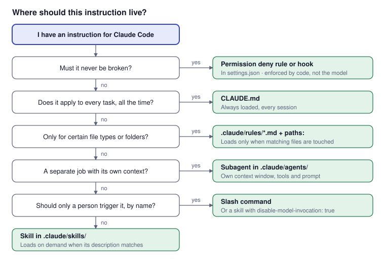
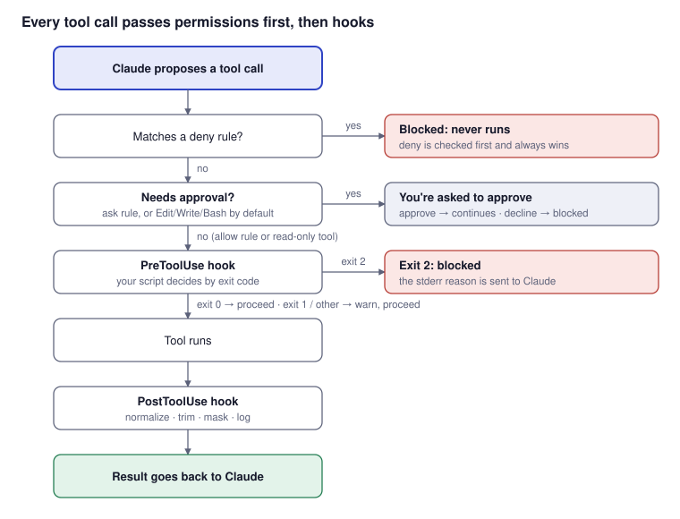
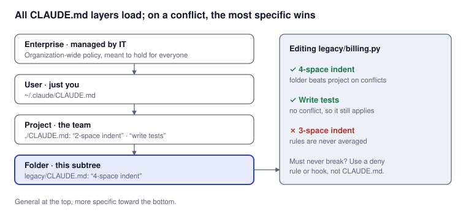
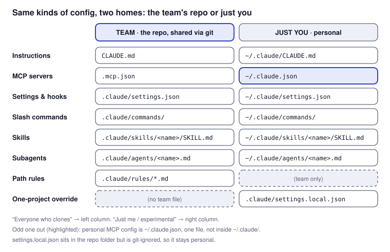
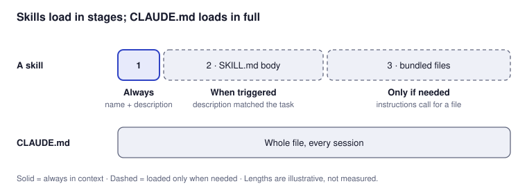
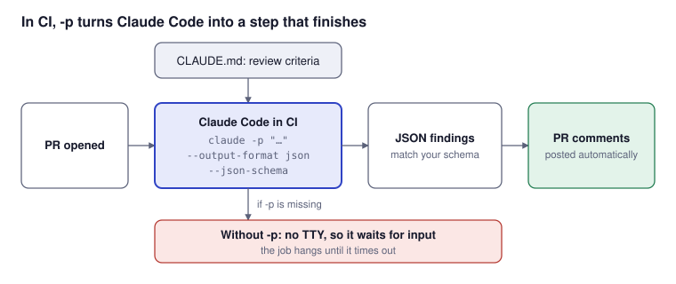

# Domain 3: Claude Code Configuration & Workflows

The most memorizable domain: which file, which folder, which flag. Most questions turn on scope (just me or the whole team) and on always-loaded versus on-demand. The six official tasks come first, then [how Claude Code works under the hood](Domain-3-Claude-Code-Configuration.md): permissions, subagents, hooks and CI flags.



*Ask the questions top to bottom and stop at the first yes. Most Domain 3 traps offer the right mechanism for a different question.*

### 3.1 CLAUDE.md hierarchy

| Level | Location | Shared? | Use for |
| --- | --- | --- | --- |
| User | `~/.claude/CLAUDE.md` | No, only you | Personal preferences |
| Project | `CLAUDE.md` at repo root or `.claude/CLAUDE.md` | Yes, via git | Team standards |
| Directory | `CLAUDE.md` in a subfolder | Yes | Conventions for that subtree |

**Concept.** Instructions load from three levels. User level applies only to you; project and directory levels are shared through git.

**Exam answer.** “A new teammate's Claude ignores our standards” means the standards sit in someone's user-level file; move them to project level. Keep files modular with `@import` (for example `@docs/api-standards.md`) or topic files in `.claude/rules/`. Run `/memory` to see which files are loaded.

**Trap.** Copy-pasting the same rules into every package's CLAUDE.md instead of `@import`; one 2,000-line CLAUDE.md.

### 3.2 Slash commands and skills

| Thing | Project (shared) | Personal |
| --- | --- | --- |
| Slash command | `.claude/commands/review.md` → `/review` | `~/.claude/commands/` |
| Skill | `.claude/skills/<name>/SKILL.md` | `~/.claude/skills/<name>/SKILL.md` |

**Concept.** [Commands and skills](FAQ-Slash-Commands-and-Skills.md) each have a project location (shared) and a personal one. Skill frontmatter: `context: fork` runs the skill in an isolated sub-agent; `allowed-tools` restricts its tools; `argument-hint` prompts for a missing argument.

**Exam answer.** A `/review` every developer gets on clone goes in `.claude/commands/`. A personal variant of a team skill goes in `~/.claude/skills/` under a **different name**. Universal always-on standards go in CLAUDE.md; occasional procedures go in an on-demand skill.

**Trap.** `~/.claude/commands/` for a team command; a `commands` array in `.claude/config.json` (it does not exist); command definitions inside CLAUDE.md.

### 3.3 Path-specific rules

```
---
paths: ["**/*.test.tsx"]
---
Use React Testing Library; no snapshot tests.
```

**Concept.** Files in `.claude/rules/` can carry YAML frontmatter with `paths:` glob patterns. They load only when Claude works on matching files, which saves context.

**Exam answer.** Conventions that follow a **file type spread across many folders** (all test files, all Terraform) use `.claude/rules/` with `paths`. This beats subdirectory CLAUDE.md files, which follow the folder rather than the file type.

**Trap.** A root CLAUDE.md saying “for test files do X” (always loaded, relies on inference); a skill (needs manual invocation); a CLAUDE.md in every folder.

### 3.4 Plan mode or direct execution

**Concept.** Plan mode explores and designs safely before touching code. Direct execution suits clear, well-scoped changes. The Explore subagent isolates verbose discovery so the main context gets a summary.

**Exam answer.** Monolith to microservices, a 45-file library migration, several valid approaches, or unknown dependencies: plan mode, then direct execution of the agreed plan. A one-file bug fix or one added validation check: direct execution.

**Trap.** Diving straight into edits on an architectural task (late surprises cause rework); plan mode for a typo fix.

### 3.5 Iterative refinement

**Concept.** Four techniques: concrete input/output examples, test-driven iteration, the interview pattern, and batching interacting problems.

**Exam answer.** Prose read inconsistently: give **2–3 concrete input/output examples**. Write tests first, then iterate by sharing failures. In unfamiliar domains, let Claude interview you first. Problems that **interact** go in one message; **independent** problems go one at a time.

**Trap.** Rewriting the prose louder or longer; splitting two bugs that cause each other into separate rounds.

### 3.6 Claude Code in CI/CD

**Concept.** `-p` (`--print`) runs non-interactively: prompt, print, exit. `--output-format json` plus `--json-schema` makes findings machine-parseable. CLAUDE.md gives CI runs the project's standards and fixtures.

**Exam answer.** Review in a [**separate session**](FAQ-Independent-Review.md) from the one that generated the code. On re-review after new commits, include prior findings so it does not repost duplicates. Give existing test files as context so suggested tests are not duplicates.

**Trap.** Piping “yes” into Claude Code; parsing free text with a regex; reviewing in the same session that wrote the code.

## Also on the exam: how Claude Code works under the hood

These topics sit around the six official task statements: permissions and settings, subagents, hooks, and SDK and CI flags. They come up inside Claude Code scenarios, so treat them as part of this domain.

### X1 Claude Code architecture, permissions and settings

**Key idea: nothing destructive runs silently.** Claude only acts through tool calls, and every call passes a permission check first. What the exam keeps testing is which actions run on their own and which need your approval.

| Action (default mode) | Needs approval? | How to change it |
| --- | --- | --- |
| Read-only tools: [Read, Grep, Glob](FAQ-Grep-Glob-Read.md) | No, runs automatically | Block specific files with a `deny` rule |
| File edits: Edit, Write | Yes | `acceptEdits` mode, or an `allow` rule |
| Shell commands: Bash | Yes | `allow` rules for safe commands, e.g. `Bash(npm test)` |
| Web fetches and MCP tools | Yes | `allow` rules per tool |
| Anything matching a `deny` rule | Blocked, never runs | Remove the rule (deny is checked first and wins) |

Rules are checked in the order **deny → ask → allow**, so a deny rule beats an allow rule for the same action. A `PreToolUse` hook adds one more gate on top that you control with code (card X5).



*Permissions are checked in the order deny, ask, allow. Hooks then add your own code: only exit code 2 blocks.*

```
// .claude/settings.json (shared with the team)
{
  "permissions": {
    "allow": ["Bash(npm test)", "Bash(npm run lint)"],
    "ask":   ["Bash(git push *)"],
    "deny":  ["Read(./.env)", "Read(./secrets/**)"]
  }
}
```

| Settings file | Scope | Shared? |
| --- | --- | --- |
| Managed (enterprise) settings | Whole organization; can’t be overridden | Set by IT |
| `~/.claude/settings.json` | All your projects | No |
| `.claude/settings.json` | This project | Yes, committed to git |
| `.claude/settings.local.json` | This project, just you | No, git-ignored |

Precedence when settings conflict: managed > command-line flags > `settings.local.json` > project `settings.json` > user `settings.json`. Permission modes: `default` (ask), `acceptEdits`, `plan` (read-only exploration), `bypassPermissions`.

**Concept.** Claude Code acts only through **explicit tool calls** (Read, Write, Edit, Bash, Grep, Glob, MCP tools). Claude proposes an action; the **permission system** decides whether it runs automatically, asks you first, or is blocked. Context lasts **within a session**. A new session starts blank and is re-established from CLAUDE.md, so anything that must survive between sessions belongs there, not in the chat.

**Exam answer.** Auto-approve safe, repeated commands (`npm test`) and deny reads of secrets (`.env`) with permission rules. Team rules go in `.claude/settings.json`; personal tweaks for one project go in `.claude/settings.local.json`. A convention Claude must follow every session goes in the project CLAUDE.md.

**Trap.** Expecting a new session to remember yesterday’s chat; telling Claude in the prompt “don’t read .env” (probabilistic) instead of a `deny` rule; using `bypassPermissions` or `--dangerously-skip-permissions` outside a sandbox.

### X2 CLAUDE.md layering and keeping files out of context



*Every layer is loaded. Only conflicting instructions are overridden, by the most specific file; nothing is blended.*

**Exam fact: one scope model everywhere.** Every kind of Claude Code configuration follows the same two tiers: a **project** file in the repo that the team shares through git, and a **user** file in your home folder that only you get. If you know which tier a question needs, you know the file.



*Every Claude Code config type has a team file in the repo and a personal file in your home folder. Pick the column first, then the row.*

| What | Project: shared via git | User: personal / experimental |
| --- | --- | --- |
| Instructions | `./CLAUDE.md` or `.claude/CLAUDE.md` | `~/.claude/CLAUDE.md` |
| MCP servers | `.mcp.json` at the repo root | `~/.claude.json` |
| Settings, permissions, hooks | `.claude/settings.json` | `~/.claude/settings.json` (or `.claude/settings.local.json` for one project) |
| Commands and skills | `.claude/commands/`, `.claude/skills/` | `~/.claude/commands/`, `~/.claude/skills/` |
| Subagents | `.claude/agents/` | `~/.claude/agents/` |

Note the odd one out: MCP’s user file is `~/.claude.json` (a file in your home folder), not inside `~/.claude/`. “Override or extend” on the slide means the same thing as “most specific wins”: a subdirectory file or path rule can add to the parent’s instructions, and where they conflict, the narrower one applies. Above both tiers sits the **enterprise** level, which IT manages and nobody can override.

**About `.claudeignore`.** It isn’t mentioned in Claude Code’s official docs, but exam questions sometimes ask about it. To keep files out of Claude’s context you can use either: a `deny` rule in settings, such as `Read(./.env)` (the documented way), or a `.claudeignore` file, which exam prep material describes as working like `.gitignore`. If either appears as the option for excluding files from context, it’s the right idea.

**Concept.** CLAUDE.md files stack in layers: **enterprise** (managed policy file set by IT) → **user** (`~/.claude/CLAUDE.md`) → **project** (`./CLAUDE.md`) → **subdirectory**. All of them load; when instructions conflict, the [**most specific wins**](FAQ-CLAUDE.md-Precedence.md). Subdirectory files load when Claude works in that folder, and `.claude/rules/` files with `paths` load only for matching files (Task 3.3).

**Exam answer.** Organization-wide rules (security, compliance) go in the enterprise file; team standards in project CLAUDE.md; folder-specific conventions in a subdirectory CLAUDE.md or a path rule. To keep files such as secrets or huge generated folders away from Claude, use `deny` rules like `Read(./secrets/**)` in settings.

**Trap.** Putting org-wide rules in one developer’s user file; assuming only the nearest CLAUDE.md loads (they all load, specific ones win on conflict). For MCP, mixing up `.mcp.json` (project, shared) and `~/.claude.json` (user, personal) is a classic distractor.

### X3 Skill frontmatter beyond the basics

**Term to know: progressive disclosure.** A skill loads in stages, so you pay context only for what’s used. The short `description` sits in context from the start (cheap). The full `SKILL.md` body loads only when the skill is triggered. Bundled files load only if the instructions call for them. This keeps the base context window lean, unlike CLAUDE.md, which loads in full every session.



*Until a skill is triggered, only its short description costs context. That is why long, occasional procedures belong in skills.*

| Stage | What loads | When | Context cost |
| --- | --- | --- | --- |
| 1. Metadata | `name` + `description` | Always, at session start | A line or two per skill |
| 2. Instructions | The `SKILL.md` body | Only when the skill is triggered | The full procedure |
| 3. Resources | Bundled files: reference docs, templates, scripts | Only if the instructions need them; scripts can run without their code entering context | Only what’s used |

Exam angles: (1) “Why move a 12-step procedure out of CLAUDE.md into a skill?” Progressive disclosure: only its description costs context until it’s needed. (2) “The skill never triggers”: Claude decides from stage 1 alone, so fix the `description`. (3) With `disable-model-invocation: true`, even the description stays out of context, because Claude never needs to decide whether to use it.

| Frontmatter | Effect |
| --- | --- |
| `description` | When Claude should use it; drives automatic loading |
| `disable-model-invocation: true` | Manual only: you can run `/name`, Claude can’t load it |
| `user-invocable: false` | Background knowledge: Claude can load it, it’s hidden from the `/` menu |
| `context: fork` | Runs in an isolated subagent; only the result returns |
| `allowed-tools` | Tools for the skill (see note below) |
| `argument-hint` | Shows the expected argument, e.g. `[environment]` |
| `paths` | Glob patterns limiting automatic loading to matching files |

**Note on `allowed-tools`.** The exam guide describes it as restricting the tools a skill may use, so answer that way on the exam. Current Claude Code docs describe it as tools the skill may use *without asking*, with a separate `disallowed-tools` field to remove tools.

**Concept.** Custom commands have been **merged into skills**: `.claude/commands/deploy.md` and `.claude/skills/deploy/SKILL.md` both create `/deploy`. Skills add a folder for supporting files, invocation control, and automatic loading when the `description` matches the task.

**Exam answer.** `disable-model-invocation: true` for skills with side effects (deploy, send messages, delete data): only a person typing `/deploy` can run it, and Claude never loads it on its own. `context: fork` isolates verbose output. `paths` limits automatic loading to matching files.

**Trap.** Leaving a production-deploy skill auto-invocable; using `user-invocable: false` (the opposite: hides it from you, lets Claude load it) when you meant manual-only.

### X4 Subagents in Claude Code

**Decision rule.** Delegate to a subagent when the work is **self-contained**, would otherwise **flood the main context** with verbose intermediate output, or benefits from a **narrower tool set**. Don’t delegate **tightly coupled, stateful** steps.

| Delegate (good fit) | Why | Keep in main session | Why |
| --- | --- | --- | --- |
| “Find every caller of `RefundGateway`” | Self-contained; hundreds of grep lines stay out of main context | A refactor where each edit depends on the last | Tightly coupled: steps share evolving state |
| “Run the test suite and summarize failures” | Verbose output; only the summary matters | Debugging that needs the whole conversation so far | The subagent starts blank and would lose that context |
| “Security-review these files” (read-only) | Benefits from a narrow, safe tool set | A one-line lookup | Spawning costs more than it saves |

Quick test: could you hand this job to a contractor with a one-paragraph brief and get back a short report? Then delegate it. If the brief would need the whole conversation, or the next step depends on every detail of this one, keep it in the main session.

```
# .claude/agents/security-reviewer.md
---
name: security-reviewer
description: Reviews code changes for security issues. Use after edits to auth, payments or input handling.
tools: Read, Grep, Glob
model: sonnet
---
Review the given files for injection, auth bypass and secrets in code.
Return JSON: {"findings": [...], "files_checked": [...], "blockers": [...]}
If you cannot check something, list it under blockers. Never guess.
```

|  | Skill with `context: fork` | Subagent |
| --- | --- | --- |
| Is | A packaged procedure | A specialist role |
| Defined in | `.claude/skills/<name>/SKILL.md` | `.claude/agents/<name>.md` |
| Both | Run in an isolated context and return only the result | Run in an isolated context and return only the result |

**Concept.** A Claude Code subagent is a **specialist with its own context window, system prompt and tools**. Define it as a Markdown file in `.claude/agents/` (team, committed) or `~/.claude/agents/` (personal), or create one with the `/agents` command. Claude delegates to it based on its `description`, or when you ask. It does the work in its own context and returns a summary. Built-in examples include Explore.

**Exam answer.** Delegate **focused, well-bounded** jobs (“find every caller of `RefundGateway`”), give the subagent only the tools its job needs, and ask for a **structured result with a blockers field** so it reports what stopped it instead of guessing.

**Trap.** Vague open-ended jobs (“improve the codebase”); giving it every tool; expecting it to see the main conversation (it [starts blank](FAQ-Subagent-Context.md)); a subagent that invents missing data rather than reporting it.

### X5 Hooks in Claude Code: events, config and exit codes

**Key idea: hooks are deterministic code, not model judgment.** Use one when you need a guarantee (“never allow `rm -rf` in this repo”) rather than a suggestion the model might not follow. A rule in CLAUDE.md is a request; a hook is enforcement.

| Pattern | Example | Event | Exit code used |
| --- | --- | --- | --- |
| Logging / audit | Record every Bash command and file edit to an audit log | `PreToolUse` or `PostToolUse` | 0 (just record, let it proceed) |
| Safety net | Block `rm -rf`, force-pushes, or edits to `migrations/` | `PreToolUse` | **2** (block, with a reason on stderr) |
| Automation trigger | Run Prettier after edits; run tests when Claude finishes; notify Slack | `PostToolUse`, `Stop`, `Notification` | 0, or 2 on `Stop` to make Claude keep working until tests pass |

Hook or `deny` rule? Both are enforced. A permission `deny` rule is the simple choice for a fixed pattern such as `Read(./.env)`. A hook fits when the check needs logic: inspecting the full command, checking a file path, or calling another script.

| Exit code | Meaning | Effect |
| --- | --- | --- |
| **0** | Success | Action proceeds (JSON on stdout can carry a decision) |
| **2** | Block | `PreToolUse`: call blocked. `UserPromptSubmit`: prompt blocked. `Stop`: Claude keeps working. stderr goes to Claude. |
| **Any other** (e.g. 1) | Non-blocking error (warn) | Action proceeds; an error notice is shown |

| Common events | Fires when |
| --- | --- |
| [`PreToolUse` / `PostToolUse`](FAQ-Hooks.md) | Before / after a tool call |
| `UserPromptSubmit` | You send a prompt |
| `SessionStart` / `SessionEnd` | A session starts / ends |
| `Stop` / `SubagentStop` | Claude / a subagent finishes responding |
| `PreCompact` | Before context is compacted |
| `Notification` | Claude Code sends a notification |

```
// .claude/settings.json
{
  "hooks": {
    "PreToolUse": [
      { "matcher": "Bash",
        "hooks": [{ "type": "command", "command": ".claude/hooks/block-dangerous.sh" }] }
    ],
    "PostToolUse": [
      { "matcher": "Edit|Write",
        "hooks": [{ "type": "command", "command": "npx prettier --write \"$FILE\"" }] }
    ]
  }
}
```
```
#!/bin/bash
# .claude/hooks/block-dangerous.sh
cmd=$(jq -r '.tool_input.command')
if echo "$cmd" | grep -qE 'rm -rf|git push --force'; then
  echo "Blocked: destructive command. Ask the user to run it manually." >&2
  exit 2
fi
exit 0
```

Simplified for study: in a real hook, read the file path from the JSON on stdin rather than `$FILE`. Deeper background: [How do hooks work?](FAQ-Hooks.md)

**Concept.** Hooks are shell commands that Claude Code runs automatically on **lifecycle events**. They’re configured in settings files under `"hooks"`, nested as event → matcher → command. The command receives event details as JSON on stdin and signals its decision through its **exit code**. (Agent SDK hooks, from Task 1.5, follow the same idea in code.)

**Exam answer.** Use hooks for anything that must happen every time: block dangerous commands (`PreToolUse` + exit 2), auto-format after edits (`PostToolUse` with matcher `Edit|Write`), audit logging, or running checks when Claude finishes (`Stop`). To block, exit with code **2** and write the reason to stderr; Claude reads the reason.

**Trap.** **Exit code 1 does not block.** It’s a non-blocking error, so the action still proceeds. Also: putting “always run Prettier” in CLAUDE.md (probabilistic); blocking a refund in `PostToolUse` (the tool already ran).

### X6 Claude Code SDK and CI/CD flags



*Pre-approve the tools the job needs (--allowedTools), because nobody is there to answer a prompt.*

**Exam fact: plan mode vs direct execution.** In plan mode, Claude explores and proposes a plan for approval *before* changing anything. Use it for **high-risk or exploratory** changes. Direct execution suits **small, well-understood, low-risk** edits. In a pipeline, `--permission-mode plan` gives you a read-only analysis run that can’t modify the repo.

| Signal in the question | Choose |
| --- | --- |
| Many files, architectural change, several valid approaches, unknown dependencies | Plan mode, then direct execution of the approved plan |
| High risk: payments, auth, migrations, production config | Plan mode, so a person approves before anything changes |
| One file, clear fix, low risk (typo, null check, rename) | Direct execution |
| CI job that should only analyze and report | `-p` with `--permission-mode plan` (or read-only `--allowedTools`) |

“Without a TTY” on the slide means no interactive terminal: nobody is there to answer a prompt. That’s why a CI run without `-p` hangs, and why every tool it needs must be allowed in advance.

| Flag | Purpose |
| --- | --- |
| `-p` / `--print` | Run once, print, exit: no interactive input |
| `--output-format text \| json \| stream-json` | Machine-readable output |
| `--json-schema` | Make the result match a schema |
| `--allowedTools` / `--disallowedTools` | Pre-approve or remove tools for this run |
| `--max-turns` | Cap agent turns in non-interactive mode |
| `--permission-mode` | e.g. `plan` for read-only analysis |
| `--resume <name>` / `--continue` | Continue a named / the most recent session |

**Concept.** The Claude Code SDK (now part of the Claude Agent SDK) gives **programmatic control of sessions** from Python or TypeScript, for building custom tools on top of Claude Code. In pipelines, the CLI runs **non-interactively** with `-p`, with no terminal and no one to answer prompts.

**Exam answer.** In CI: `claude -p` with `--output-format json` and `--json-schema` for parseable results, `--allowedTools` limited to what the job needs, `--max-turns` as a runaway guard, and secrets passed as environment variables. CLAUDE.md supplies the project’s standards to the CI run.

**Trap.** Skipping permissions entirely to avoid prompts; running without `-p` (the job hangs); parsing free-text output with regex.

## Exam scenario lens: where this domain shows up

Claude Code configuration isn’t limited to the two Claude Code scenarios. It appears in all six, so expect its ideas inside any scenario you draw.

| Scenario | How this domain appears | Typical question | Answer |
| --- | --- | --- | --- |
| **Code Generation with Claude Code** | CLAUDE.md conventions, plan mode for risky refactors, subagents for isolated file-level work | “A new teammate’s Claude ignores our API conventions.” | Move them from a user-level file to the project CLAUDE.md (Task 3.1) |
| **Claude Code for CI/CD** | `-p` non-interactive mode, `--output-format json` (+ `--json-schema`) for machine-readable results | “The review job hangs until it times out.” | `claude -p`; parse JSON output, never regex free text (Task 3.6, X6) |
| **Developer Productivity with Claude** | Custom slash commands and skills for repeatable team workflows; keeping noisy directories out of context | “Every developer who clones should get `/triage`.” | `.claude/commands/` or `.claude/skills/` in the repo (Task 3.2, X3) |
| **Multi-Agent Research System** | Subagent delegation for parallel, isolated research streams | “Raw search output is flooding the main context.” | Delegate each stream to a subagent that returns a structured summary (X4) |
| **Customer Support Resolution Agent** | Hooks as safety nets: deterministic blocks on disallowed actions, regardless of model judgment | “Refunds over $500 still slip through despite the prompt.” | A `PreToolUse` hook that blocks and redirects to escalation (X5, Task 1.5) |
| **Structured Data Extraction** | SDK-driven programmatic sessions producing schema-constrained output | “Pipeline results must always match our schema.” | Programmatic run with `--json-schema` / tool-use schema; validate semantics separately (X6, Task 4.3) |

Two scenarios are built with the Agent SDK rather than the Claude Code CLI: Customer Support and Multi-Agent Research. There, “hooks” are Agent SDK hooks in code, and subagents are spawned with the `Task` tool rather than `/agents`. The ideas are identical: deterministic enforcement, and isolated workers that start blank.

## Common exam traps

The first four come from your slide deck; the last four come up repeatedly elsewhere in this course.

**Trap 1:** **[Assuming a subdirectory CLAUDE.md is merged or averaged with the parent.](FAQ-CLAUDE.md-Precedence.md)**

**Why it’s wrong:** The more specific scope wins. Where a subdirectory rule conflicts with a parent rule, the subdirectory rule applies outright; the two are never blended into a compromise. Parent rules that *don’t* conflict still apply, because every layer is loaded.

**Example:** Root says “2-space indent”, `legacy/CLAUDE.md` says “4-space indent”: files in `legacy/` get 4 spaces, not 3.

**Trap 2:** **Confusing `.mcp.json` (project, shared) with `~/.claude.json` (user, personal).**

**Why it’s wrong:** Project config is version-controlled and team-shared; user config is local and experimental. Decide which one the question describes first.

**Example:** “Everyone who clones” → `.mcp.json`. “Try a server without affecting teammates” → `~/.claude.json`.

**Trap 3:** **Choosing direct execution for a large, high-risk, exploratory change.**

**Why it’s wrong:** Plan mode is the safer, exam-correct choice whenever the blast radius or ambiguity is high.

**Example:** “Migrate 45 files to a new auth library” → plan mode. “Fix a typo in one file” → direct.

**Trap 4:** **Using a hook where model judgment is needed, or vice versa.**

**Why it’s wrong:** Hooks give deterministic guarantees: use them for hard constraints you can write as an `if`. Nuanced decisions belong to the model, guided by the prompt.

**Example:** “Never run `rm -rf`” → hook. “Escalate when policy is ambiguous” → prompt criteria with few-shot examples.

**Trap 5:** **Expecting exit code 1 to block a hook’s action.**

**Why it’s wrong:** Only exit code **2** blocks. Exit 1, like any other non-zero code, is a non-blocking warning and the action proceeds.

**Example:** A safety-net hook that “fails” with exit 1 lets the dangerous command run.

**Trap 6:** **Putting team standards in a user-level file.**

**Why it’s wrong:** `~/.claude/` files reach only their owner. Anything the team relies on goes in the repo’s `.claude/` or root CLAUDE.md.

**Example:** “Works for the senior dev, not the new hire” is the classic symptom.

**Trap 7:** **Running Claude Code in CI without `-p`.**

**Why it’s wrong:** There’s no TTY in CI, so any prompt waits forever.

**Example:** “The pipeline hangs until it times out” → `-p`.

**Trap 8:** **Committing secrets in `.mcp.json`.**

**Why it’s wrong:** Reference them as environment variables with `${VAR}` expansion.

**Example:** `"Authorization": "Bearer ${GITHUB_TOKEN}"`.

## Key terminology

Short definitions to recognize instantly on the exam. The last column shows where each term is covered in depth.

| Term | Meaning | Covered in |
| --- | --- | --- |
| **CLAUDE.md** | The layered instruction file (enterprise / user / project / subdirectory) that gives Claude Code persistent project context. All layers load; the most specific wins on conflict. | X2, Task 3.1 |
| **.claudeignore** | Excludes files and folders from Claude Code’s context, like `.gitignore`. Not in the official docs, but it comes up in exam questions. A `deny` rule such as `Read(./.env)` does the same job and is the documented way; either is a valid answer. | X2 |
| **SKILL.md** | The file that defines an Agent Skill: YAML frontmatter plus instructions. Claude loads it automatically when its `description` matches the task, unless `disable-model-invocation: true`. | X3, Task 3.2 |
| **`context: fork`** | SKILL.md frontmatter that runs the skill in an isolated subagent, so its verbose output doesn’t pollute the main session. | X3, Task 3.2 |
| **Subagent (Claude Code)** | A delegated, separately scoped agent created via `/agents` (stored in `.claude/agents/`), running in its own context window with its own prompt and tools. | X4 |
| **Hooks** | Deterministic code that fires on lifecycle events (tool calls, session start/stop) to enforce guarantees, not via model judgment. Exit 0 proceeds, exit 2 blocks, other codes warn. | X5, Task 1.5 |
| **Exit code conventions** | The hook return codes that signal the outcome back to Claude Code: **0** success (proceed), **2** block (stderr goes to Claude), **any other** code is a non-blocking warning. Exit 1 does *not* block. | X5 |
| **`-p` / `--print`** | Non-interactive mode: runs Claude Code without a terminal UI (no TTY), for scripts and CI/CD pipelines. Without it, a CI job hangs waiting for input. | X6, Task 3.6 |
| **`--output-format json`** | CLI flag producing machine-parseable JSON output, often paired with `--json-schema` for structured CI results such as PR comments. | X6, Task 3.6 |
| **Plan mode** | Claude explores and proposes a plan that is approved before any changes are made. Safer for high-risk or exploratory edits; direct execution suits small, low-risk ones. | X6, Task 3.4 |
| **`.mcp.json`** | Project-level MCP server configuration, checked into version control and shared with the team. Use `${ENV_VAR}` for secrets. | X2, Task 2.4 |
| **`~/.claude.json`** | User-level MCP server configuration: personal and experimental, not shared via version control. A single file in your home folder, not inside `~/.claude/`. | X2, Task 2.4 |
| **Progressive disclosure** | A skill loads in stages: description always, full SKILL.md body only when triggered, bundled files only when needed. Keeps the base context lean. | X3 |
| **TTY** | An interactive terminal where a person can answer prompts. CI pipelines have none, so Claude Code must run with `-p` and pre-approved tools. | X6, Task 3.6 |

## Check yourself

This domain's interactive quiz is on the [live site](https://ppotdar.github.io/ccaf-study-course/#d3). The same questions, with answers, are on [Practice Questions](Practice-Questions.md).


---

← [Domain 1 Agentic Architecture](Domain-1-Agentic-Architecture.md) · [Home](README.md) · [Domain 4 Prompt Engineering and Structured Output](Domain-4-Prompt-Engineering-and-Structured-Output.md) →

Unofficial CCAF study guide · not affiliated with Anthropic · [Interactive site](https://ppotdar.github.io/ccaf-study-course/) · © 2026 Puja Potdar · [CC BY-NC 4.0](https://creativecommons.org/licenses/by-nc/4.0/)
