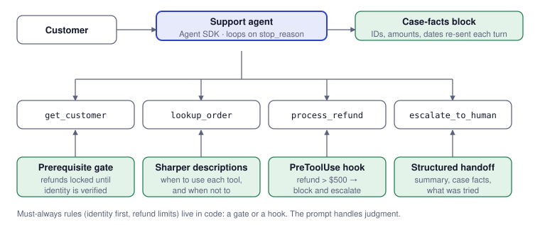
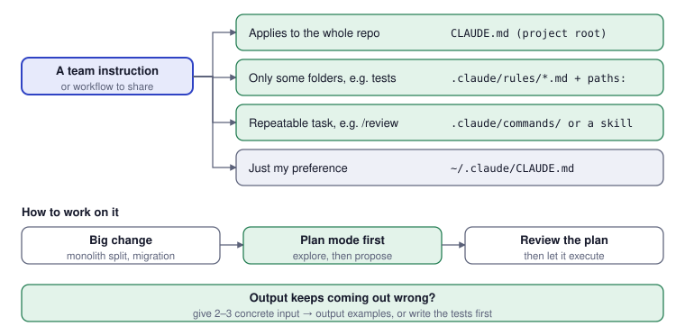
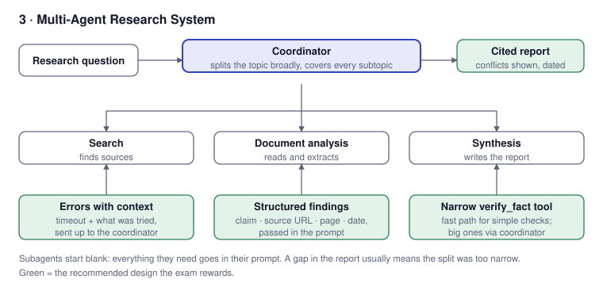
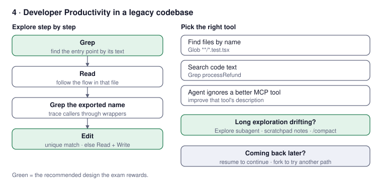
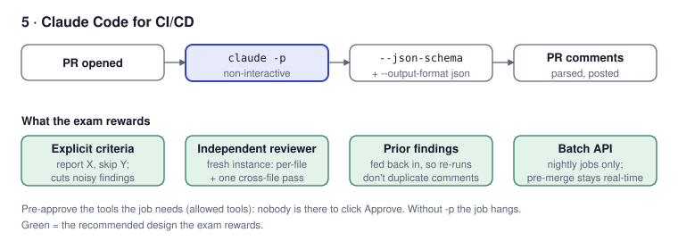
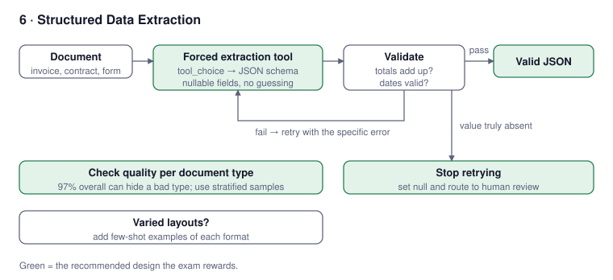

# Scenario playbook

The exam draws 4 of these 6 scenarios at random, and every question sits inside one of them. Each section below gives the setup, a picture of the system with the recommended design **in green**, the types of questions it asks, and the recurring symptoms with their answers. If you can answer the right-hand columns from memory, you are ready for that scenario.

## 1. Customer Support Resolution Agent

**Setup:** An Agent SDK agent with MCP tools `get_customer`, `lookup_order`, `process_refund` and `escalate_to_human`. Target: 80%+ first-contact resolution. **Main domains:** 1, 2, 5.

*The agent works through four MCP tools. Policies that must always hold sit in code next to the tools; the case-facts block keeps key numbers alive in long chats.*

### Types of questions

- Enforcing must-follow policies (identity check, refund limits) with hooks or gates rather than prompts
- Tool misrouting
- When and how to escalate to a human
- Keeping case facts through long chats
- Structured tool errors

### Symptom → answer

| Symptom in the question | Answer pattern | Task |
| --- | --- | --- |
| Agent skips identity check | [Programmatic prerequisite gate](FAQ-Programmatic-Prerequisites.md) | 1.4 |
| Refunds over the limit slip through | Pre-call hook blocks and redirects to escalation | 1.5 |
| Wrong tool for “check my order” | Expand and differentiate tool descriptions | 2.1 |
| 55% first-contact resolution | Explicit escalation criteria plus few-shot | 5.2 |
| “Get me a human” | Escalate now, with a structured handoff | 5.2, 1.4 |
| [Facts lost in long chats](FAQ-Protecting-Context.md) | Case-facts block, trimmed tool output | 5.1 |

## 2. Code Generation with Claude Code

**Setup:** A team uses Claude Code day to day, with CLAUDE.md files, slash commands and plan mode. **Main domains:** 3, 5.

*Pick the file by who needs the instruction and where it applies. The personal file (shaded) is never shared, which is why teammates miss instructions placed there.*

### Types of questions

- Which file and scope an instruction belongs in (CLAUDE.md levels, `.claude/rules/` with `paths`)
- Team commands and skills
- Plan mode vs direct execution
- Fixing output with concrete examples or tests
- Context in long sessions

### Symptom → answer

| Symptom in the question | Answer pattern | Task |
| --- | --- | --- |
| Teammates don't get instructions | Move from user-level to project CLAUDE.md | 3.1 |
| [Team `/review` command](FAQ-Slash-Commands-and-Skills.md) | `.claude/commands/` | 3.2 |
| Test-file conventions across folders | `.claude/rules/` with `paths` | 3.3 |
| Monolith split or big migration | Plan mode first | 3.4 |
| Transformation keeps coming out wrong | 2–3 concrete I/O examples, or tests first | 3.5 |

## 3. Multi-Agent Research System

**Setup:** A coordinator delegates to search, document-analysis and synthesis subagents, then assembles a cited report. **Main domains:** 1, 2, 5.

*The coordinator owns the split and the routing. Each subagent gets structured inputs, reports errors with context, and keeps claim-to-source links so the final report can cite and date every figure.*

### Types of questions

- Diagnosing gaps (coordinator decomposition vs a weak subagent)
- What context to pass to subagents
- Which tools each agent gets (e.g. `verify_fact`)
- Passing errors up to the coordinator
- Keeping citations and handling conflicting sources

### Symptom → answer

| Symptom in the question | Answer pattern | Task |
| --- | --- | --- |
| Report misses whole subtopics | [Coordinator decomposition](FAQ-Coordinator-Decomposition.md) too narrow | 1.2 |
| [Synthesis doesn't know what search found](FAQ-Subagent-Context.md) | Pass full findings explicitly, structured | 1.3 |
| Search timeout | Structured error context to the coordinator | 5.3, 2.2 |
| Fact checks add 40% latency | Scoped `verify_fact` tool | 2.3 |
| Citations lost; conflicting stats | Claim-to-source mapping; annotate conflicts with dates | 5.6 |

## 4. Developer Productivity

**Setup:** Engineers explore and change an unfamiliar legacy codebase with Read, Write, Edit, Bash, Grep, Glob and MCP tools. **Main domains:** 2, 3, 1.

*Start narrow with Grep, read only what the trail leads to, and protect your context on long explorations. Glob finds files by name; Grep searches inside them.*

### Types of questions

- Picking the right built-in tool (Grep vs Glob vs Read/Edit)
- Exploring incrementally
- Why the agent ignores a better MCP tool
- Answers drifting in long explorations (subagents, scratchpad, `/compact`)
- Resume vs fork vs a fresh session

### Symptom → answer

| Symptom in the question | Answer pattern | Task |
| --- | --- | --- |
| [Find files vs find code](FAQ-Grep-Glob-Read.md) | Glob vs Grep | 2.5 |
| Agent prefers Grep over a better MCP tool | Improve the MCP tool's description | 2.4 |
| Long exploration, answers drifting | Subagents, scratchpad, `/compact`, Explore | 5.4, 3.4 |

## 5. Claude Code for CI/CD

**Setup:** Claude Code runs unattended in a pipeline: automated code review, test generation and PR comments. **Main domains:** 3, 4.

*In CI, Claude Code must run without prompts and return machine-readable output. Quality comes from explicit criteria and an independent reviewer, not from asking it to be more careful.*

### Types of questions

- Non-interactive flags (`-p`, `--output-format json`, `--json-schema`, allowed tools)
- Cutting noisy or false-positive findings with explicit criteria
- Duplicate comments on re-runs
- Independent review vs self-review
- Batch API vs real-time for cost

### Symptom → answer

| Symptom in the question | Answer pattern | Task |
| --- | --- | --- |
| Pipeline hangs | `claude -p` | 3.6 |
| Need parseable PR comments | `--output-format json --json-schema` | 3.6 |
| Developers ignore noisy findings | Explicit criteria; disable the noisy category | 4.1 |
| Duplicate comments on re-run | Include prior findings in context | 3.6 |
| [Self-review misses bugs](FAQ-Independent-Review.md) | Independent instance; per-file plus cross-file | 4.6 |
| Cut cost on pre-merge and nightly jobs | Batch only the nightly jobs | 4.5 |

## 6. Structured Data Extraction

**Setup:** Unstructured documents (invoices, contracts, forms) are turned into JSON that matches a schema and is validated. **Main domains:** 4, 5.

*The schema guarantees shape; validation checks meaning. Retry only when the error is fixable, and never let the model invent a value the document doesn't contain.*

### Types of questions

- Forcing the schema with tool use and `tool_choice`
- Nullable fields vs invented values
- Validation-and-retry loops and when to stop retrying
- Few-shot examples for varied formats
- Measuring accuracy per document type and routing to human review

### Symptom → answer

| Symptom in the question | Answer pattern | Task |
| --- | --- | --- |
| Malformed JSON | Tool use with a JSON schema | 4.3 |
| Invented values for missing fields | Nullable fields | 4.3 |
| Totals don't add up | Semantic validation, retry with specific errors | 4.4 |
| Retry keeps failing on absent data | Stop retrying; null plus human review | 4.4 |
| 97% overall, bad on one doc type | Segment accuracy; stratified sampling; calibration | 5.5 |

## Answering technique (2 minutes per question)

1. Read the **last sentence** first: is it asking for the root cause, the best fix, or the most efficient fix?
2. Name the task statement in your head (“this is 1.4 enforcement”).
3. Eliminate the probabilistic option if the rule must always hold, and the over-engineered option if a simpler fix works.
4. Between the last two, pick the one that fixes the **cause** rather than masking the symptom.
5. Flag and move on after 2.5 minutes. Never leave a blank.

---

← [Domain 5 Context Management and Reliability](Domain-5-Context-Management-and-Reliability.md) · [Home](README.md) · [Cheat Sheet](Cheat-Sheet.md) →

Unofficial CCAF study guide · not affiliated with Anthropic · [Interactive site](https://ppotdar.github.io/ccaf-study-course/) · © 2026 Puja Potdar · [CC BY-NC 4.0](https://creativecommons.org/licenses/by-nc/4.0/)
